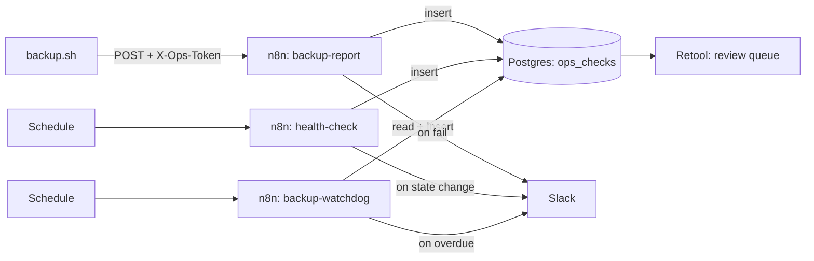
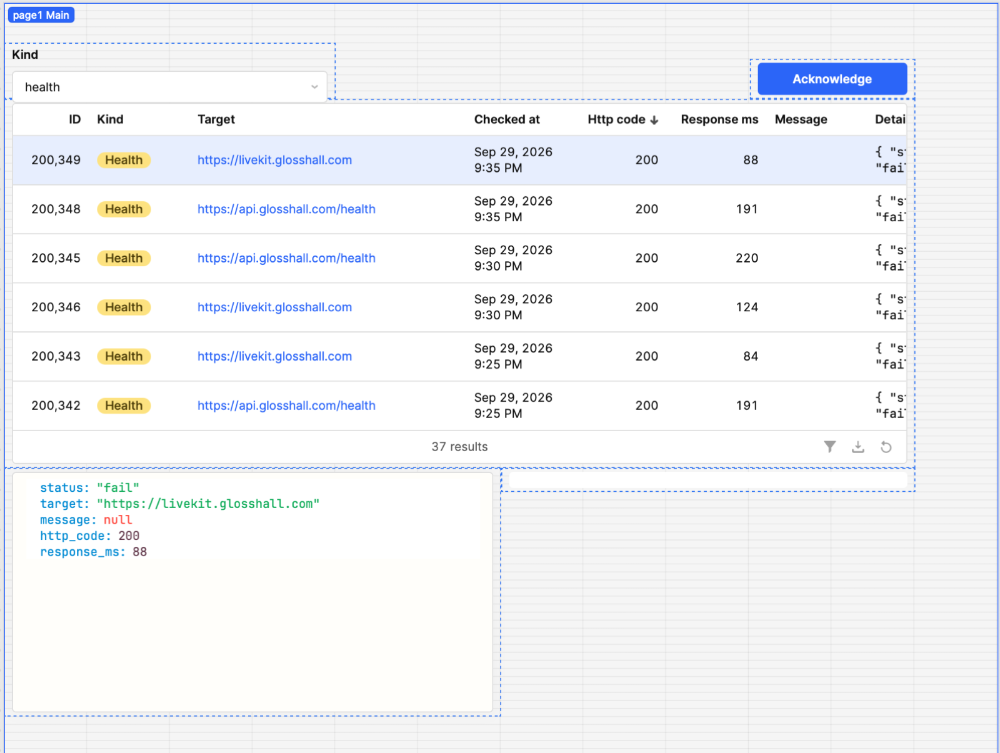
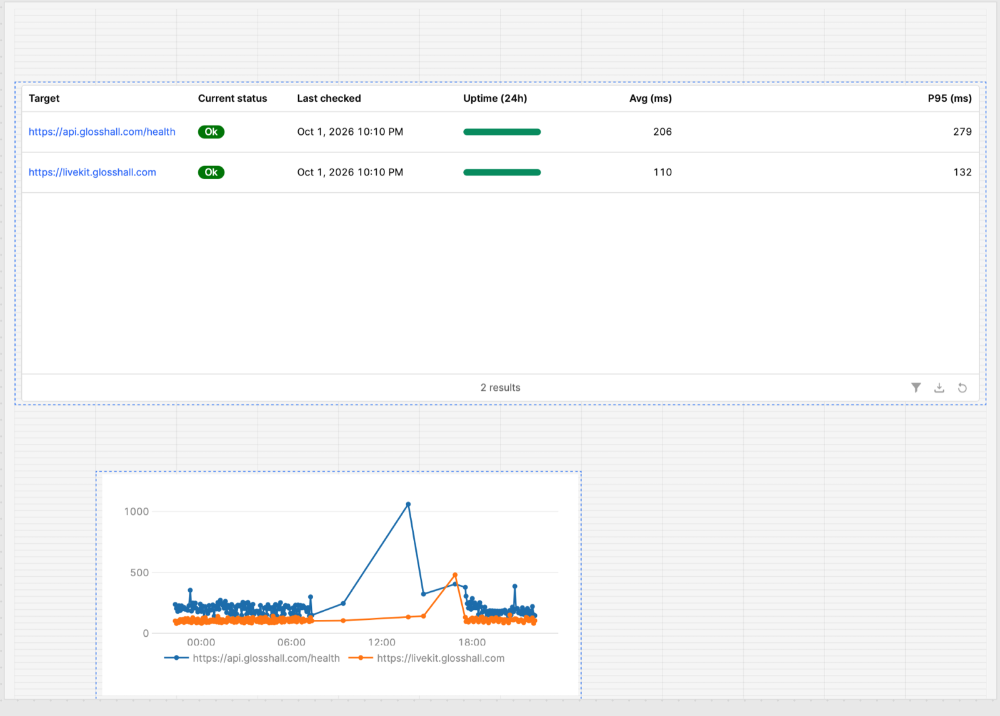
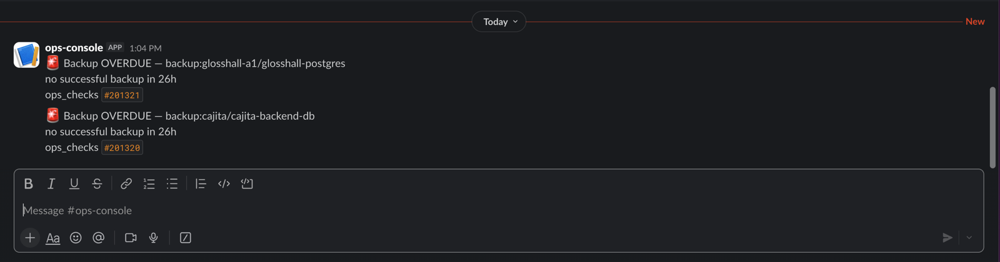
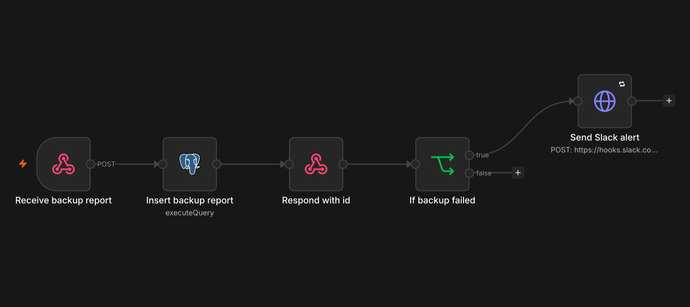
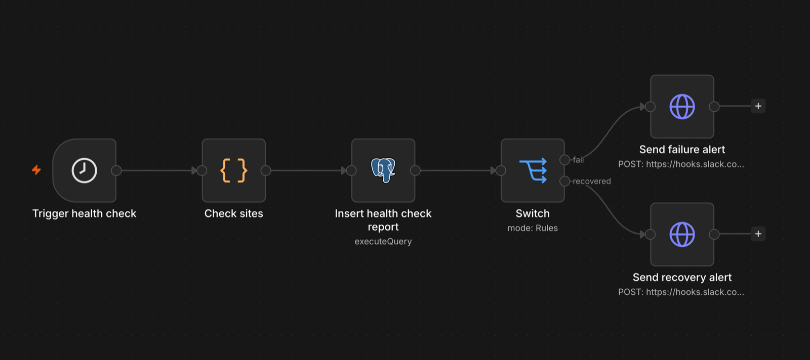
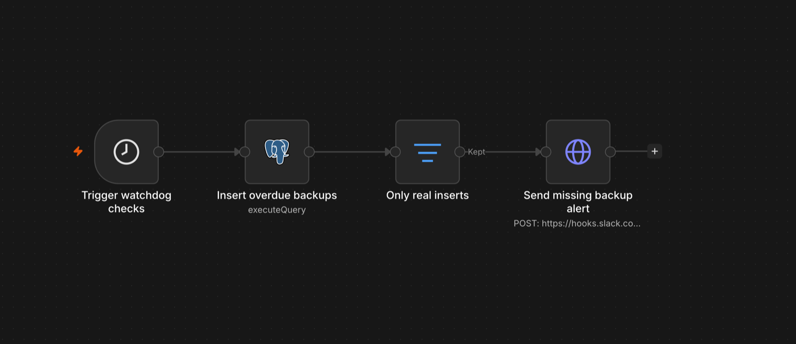

# ops-console

*Built with n8n · PostgreSQL · Retool · Slack · Docker*

My production databases had no backups, and nothing would tell me if a site went
down. ops-console is a self-hosted monitoring and operations console that records
backup reports and health checks, alerts on failures, and gives a person a queue
to work through — so problems get noticed and handled instead of discovered too late.

## What it does

- **Backup reporting** — receives backup reports via an authenticated webhook and
  records them, alerting on failures and on backups that never ran.
- **Health checks** — probes a list of sites every 5 minutes, recording status and
  response time, and alerts only when a site *changes* state (down or recovered).
- **Review queue** — a Retool app where an operator reviews open failures and
  acknowledges them, with per-user attribution and race-safe updates.

See [docs/runbook.md](docs/runbook.md) for what to do when each alert fires.

## Architecture



The `ops_checks` table is the contract that ties everything together. n8n and Retool
never talk to each other directly — every workflow writes to the table, and Retool
reads and acknowledges from it. Adding a new producer (or consumer) means agreeing on
the table's shape, nothing more.

## Try it

Send a backup report through the webhook (the contract lives in `examples/`):

```bash
curl -i -H 'Content-Type: application/json' -H "X-Ops-Token: $N8N_TOKEN" \
  -X POST -d @examples/backup-fail.json \
  'http://localhost:5678/webhook/backup-report'
```

A `status: "fail"` report records the failure and fires a Slack alert; the response
returns the new row's id.

## Design decisions

| Decision | Why |
|---|---|
| Least-privilege DB roles (`ops_writer` = insert/select only; `ops_reviewer` = select + column-scoped update on three columns) | A stolen credential can only do its job, not drop the table or hide an incident. A reviewer literally cannot change a failure's `status`. |
| Parameterized queries everywhere (`$1`, Retool `{{ }}`) | Values are sent separately from SQL text, so user/report data can never be parsed as SQL. Verified with an injection payload stored verbatim. |
| Respond to the webhook before sending the Slack alert | The caller only asked "did you record my report?" A failure in a separate side-effect (Slack down) must not make the answer falsely say no, which would cause retries and duplicate rows. |
| Alert on *state change*, not every result | A site down for an hour would otherwise post every 5 minutes. Alert fatigue means real alerts get ignored. The insert returns the previous status so the workflow fires only on ok→fail and fail→ok. |
| Watchdog uses a LEFT JOIN against a hardcoded expected-targets list | A backup that never ran has zero rows — a plain query over existing rows can't see it. The LEFT JOIN keeps the expected target with a NULL match, which is how "never backed up" is detected. The `ok`/`backup` filters go in `ON`, not `WHERE`, or the LEFT JOIN silently collapses to an INNER JOIN and drops the missing target. |
| Anti-spam guard: insert an overdue row only `where not exists` an open one; alert only on `returning` rows | Records the problem once and alerts once, not every hour. Acknowledging without fixing lets it re-alert — "you marked it handled, but it isn't." |
| Partial index `(checked_at desc) where status='fail' and acknowledged=false`; composite `(target, checked_at desc)` | The queue query stays fast via the partial index (it only covers open failures). The composite index turns the health-check's per-target "most recent row" lookup — the prev-status CTE that runs every 5 minutes, once per target — into a single index scan instead of a sequential scan that grows with the table. |
| Acknowledge guard: `update ... where id = ? and acknowledged = false returning id` | Two operators acknowledging the same row: the second update matches zero rows, so the UI tells them it was already handled instead of silently overwriting the first. |
| Found and fixed a false "ok": Cloudflare Access was answering health checks with its login page | A check that can't fail is worse than no check, because you trust it. Replaced the Access-protected targets with a directly reachable one; the real fix (a service token) is noted under "what I'd add next." |

## Screenshots

### Review queue


### Health overview


*The flat stretch mid-chart is n8n being offline (laptop asleep). Nothing alerted
during that window — which is exactly the "monitor the monitor" gap described under
Status & what I'd add next.*

### Slack alerts


### n8n workflows

#### `backup-report` — webhook → insert → respond → alert on failure


#### `health-check` — every 5 min: check sites → insert → alert on state change


#### `backup-watchdog` — hourly: record overdue backups → alert on new ones


## Repo layout

| Path | What's in it |
|---|---|
| `schema.sql` | The full current table definition — use this for a fresh install. |
| `migrations/` | Ordered migrations that take the original table to its current shape (`001` columns + constraints, `002` writer role, `003` composite index, `004` reviewer role). |
| `workflows/` | Exported n8n workflows (secrets redacted by the export script). |
| `scripts/` | `export-workflows.sh` — exports and scrubs workflows before they're committed. |
| `examples/` | Sample request bodies (the backup-report contract). |
| `docs/` | Runbook, this README's images. |

## Running it locally

**Prerequisites:** Docker, a PostgreSQL database (this project uses Neon), and `psql`.

1. **Configuration.** Copy `.env.example` to `.env` and fill in the values
   (database URL, webhook token). `.env` is gitignored — never commit real secrets.
   Load it into your shell:
```bash
   cp .env.example .env
   # edit .env, then:
   set -a; source .env; set +a
```

2. **Database schema.**
   - Fresh install: `psql "$DATABASE_URL" -f schema.sql`
   - Existing database: run the files in `migrations/` in order.

3. **Create the two database roles** (set passwords by hand — they live only in the
   n8n and Retool credentials, never in the repo):
```sql
   create role ops_writer   with login password '...';
   grant select, insert on ops_checks to ops_writer;
   grant usage on sequence ops_checks_id_seq to ops_writer;

   create role ops_reviewer with login password '...';
   grant select on ops_checks to ops_reviewer;
   grant update (acknowledged, ack_by, ack_at) on ops_checks to ops_reviewer;
```

4. **Start n8n:**
```bash
   docker compose up -d n8n
```

5. **Import the workflows** (the inverse of `scripts/export-workflows.sh` — copy the
   files into the container, then import the folder):
```bash
   docker compose cp workflows/. n8n:/tmp/wf/
   docker compose exec n8n n8n import:workflow --separate --input=/tmp/wf/
```
   Then, in the n8n UI, set the credentials that aren't stored in the repo: the
   Postgres credential (connect as `ops_writer`), the webhook token (`X-Ops-Token`
   header auth), and the Slack webhook URL in each HTTP Request node. Publish each
   workflow so its schedule/webhook is active.

6. **Connect Retool:** add a PostgreSQL resource pointing at the same database,
   connecting as `ops_reviewer` with SSL enabled. Build or import the review-queue
   and health-overview pages.

## Status & what I'd add next

**Current status:** n8n runs locally (Docker), not deployed. `backup.sh` isn't
deployed yet — which is why the watchdog is correctly reporting that both real
databases have no backups. The system works end to end against live targets.

**What I'd add next:**
- **Deploy** n8n and `backup.sh` to a VM (step 8) so backups actually run and the
  webhook is reachable at a stable URL.
- **Monitor the monitor** — an external dead-man's-switch (e.g. healthchecks.io)
  that alerts if n8n itself stops; right now nothing would notice.
- **Events vs. incidents** — the queue shows one row per failed check, so one
  outage can be many rows. Collapse into incidents (latest failure per target, or
  "acknowledge all for this target").
- **Service tokens for Access-protected apps** so health checks reach the real app
  instead of the Cloudflare login page.
- **Row retention policy** — `ops_checks` grows unbounded; archive or age out old
  rows.